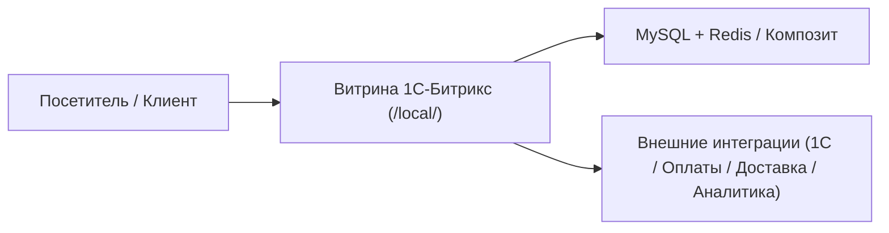

# Архитектурная карта проекта {{PROJECT_NAME}} (Codemap & Entities)

## 1. Сайты и контуры (`SITE_ID`)

| Site ID | Домен | Роль (prod / staging / crm) | Валюта витрины | Регион / Язык | Особенности |
|---|---|---|---|---|---|
| `s1` | `{{PRIMARY_DOMAIN}}` | {{SITE_ROLE}} | {{CURRENCY}} | {{REGION}} | {{NOTES}} |

---

## 2. Сервисы и классы ядра (`/local/`)
- **Инициализация**: `local/php_interface/init.php` (автозагрузчик, константы, события).
- **Классы (`local/php_interface/classes/` или `local/modules/`)**:
  - *(заполняется по результатам скана `bitrix-project-scan.mjs` и интервью — без домыслов)*

---

## 3. Инфоблоки, Каталог и Highload-блоки

### 3.1. Инфоблоки (`b_iblock`)
| IBLOCK_ID | Код / Название | Назначение | Ключевые свойства |
|---|---|---|---|
| *(уточнить)* | | | |

### 3.2. Highload-блоки
| HL ID | Таблица / Имя | Назначение |
|---|---|---|
| *(уточнить)* | | |

---

## 4. Шаблоны, Компоненты и AJAX-точки
- **Шаблоны (`local/templates/`)**: {{TEMPLATES_LIST}}
- **Кастомные компоненты (`local/components/`)**: {{CUSTOM_COMPONENTS_LIST}}
- **AJAX-обработчики (`local/ajax/`)**: {{AJAX_ENDPOINTS_LIST}}
- **ЧПУ (`urlrewrite.php`)**: {{URLREWRITE_SUMMARY}}

---

## 5. Внешние интеграции и инфраструктура
- **1С / Учётная система**: {{ERP_INTEGRATION}}
- **CRM / Аналитика**: {{CRM_AND_ANALYTICS}}
- **Оплаты и доставки**: {{PAYMENTS_AND_DELIVERY}}
- **Кэширование / Сервер**: {{SERVER_AND_CACHE}}

